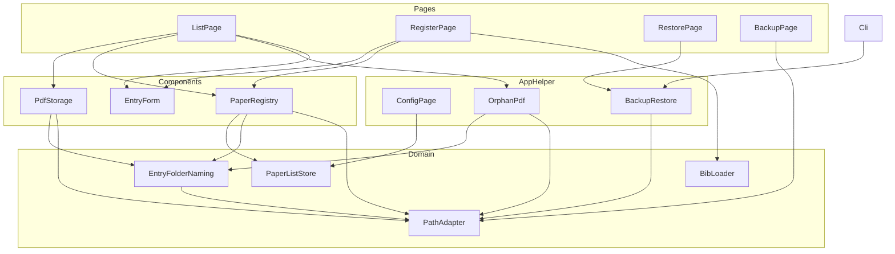
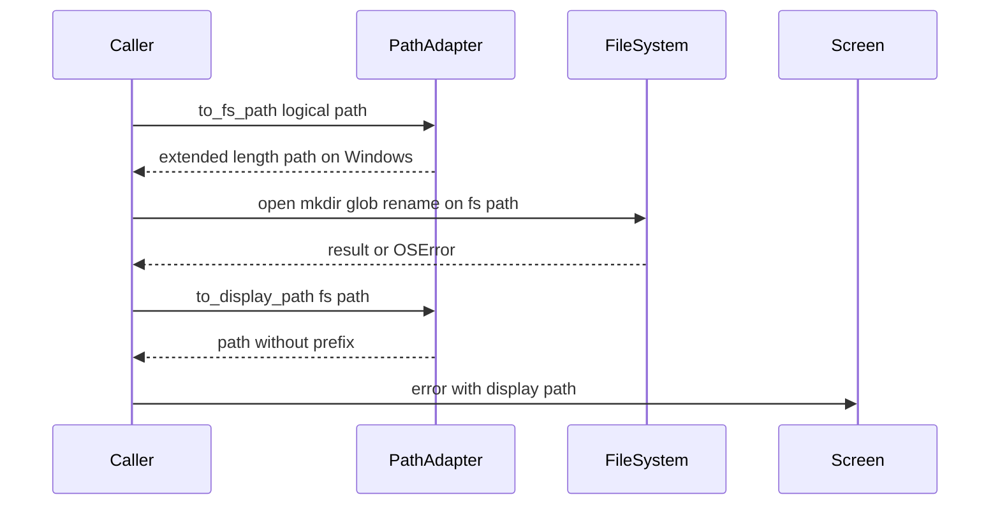
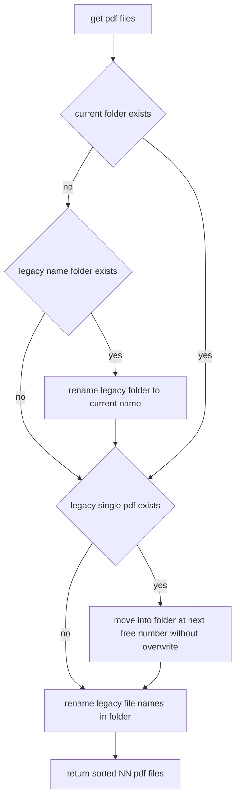
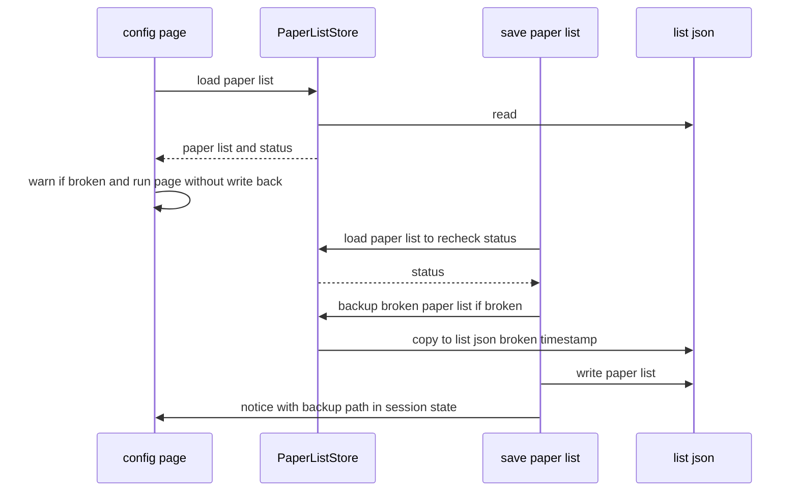
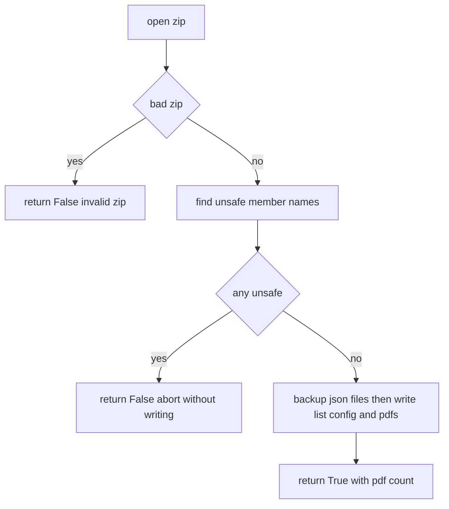

# Design Document

## Overview
**Purpose**: paper-manager の既知バグ（test-suite spec の KB1〜KB10）、利用者から報告された Windows で長いパスの PDF が表示されない不具合、観察として記録した不具合 5 件、および実装中に見つかった引用キーと BOM 付きの論文リストの問題を修正する。修正した既知バグの strict xfail は外し、通常のテストとして成功させる。

**Users**: ローカルで論文と PDF を管理する単一の利用者。特に、Windows で保存先ディレクトリを長いパスにしている利用者と、BibTeX・DOI・手動入力で論文を登録・編集する利用者。

**Impact**: PDF のファイル操作は、Windows では拡張長のパスを通して行うようになる。PDF フォルダ名の生成、重複の判定、論文リストの保存経路、復元、CLI の引数処理、引用キーの生成と BibTeX の表示・エクスポートを修正する。既存の論文リスト・設定・PDF フォルダはそのまま読み込め、KB7 の範囲のフォルダだけが新しい名前へ自動で移る。

### Goals
- Windows で、パス全体が 260 文字を超える PDF を、他の PDF と同じように保存・表示・削除・エクスポート・バックアップ・復元できる
- KB1〜KB10 と観察事項 5 件を修正し、対応するテストが通常のテストとして成功する
- 修正前に作成された論文リスト・設定・PDF フォルダを、修正後もそのまま読み込み、PDF を表示できる

### Non-Goals
- OS ごとのファイル名の置換規則の違いによる、OS をまたいだデータ移行時の不整合
- Linux のファイル名の上限（255 バイト）による、長い非 ASCII タイトルのフォルダの作成失敗
- 既に `, ` 区切りで保存されている著者の自動変換
- 孤立 PDF の削除に渡すパスの検証、壊れた設定ファイルへの保存時のプロキシ以外の設定の消失、DOI の任意項目が空の値で保存される問題
- Windows の Explorer で 260 文字を超えるパスを扱えるようにすること

## Boundary Commitments

### This Spec Owns
- Windows の拡張長のパスへの変換と、表示用のパスへの逆変換（新しい `helper/_path.py`）
- フォルダ名の同一性を判定する比較キー（大文字小文字と Unicode 正規化を区別しない）
- PDF フォルダ名の生成規則の修正（KB2a、KB5、KB7）、修正前の規則の名前の計算と、そのフォルダの移行（2.7）、旧形式の単一 PDF のフォルダへの統合（8.3）
- PDF の保存・削除・一覧・ビューア・エクスポート・孤立判定・バックアップ・復元の各処理での、変換後のパスの使用と失敗の画面表示
- 論文の登録・更新の重複判定と、大文字小文字だけの改名
- 手動入力フォームの著者・タグ・年
- BibTeX の人名の整形と、著者のない BibTeX の読み込み、登録ページでの構文エラーの扱い
- DOI のメタデータの取得時のエラー処理と、Crossref の応答から Entry への変換
- 論文リストの読み込みの状態（正常・ファイルなし・壊れている）の判定（BOM 付きの UTF-8 を正常として読む）、壊れたファイルの退避、ページ描画後の書き戻しの廃止
- 引用キーの生成規則（BibTeX の引用キーとして読めない文字を除く）と、表示・エクスポートでの既存の引用キーの整形と重複の解消
- 復元のメンバー名の検証と、復元処理の helper への一本化
- CLI の引数の振り分け（backup / restore / run / version）
- 上記に対応するテストの追加・更新と、修正した既知バグの xfail の解除

### Out of Boundary
- 上記 Non-Goals のすべて
- `fields.json` の必須項目の定義（変更しない）
- streamlit-pdf-viewer、pybtex、crossrefapi の内部の挙動
- test-suite spec の文書（requirements / design / tasks）。この spec が test-suite の要件 9.3（250 文字で保存をスキップする）を置き換えることは、この spec で記録する
- `{Barnes and Noble}` のような波括弧付きの団体名が、フォルダ名と識別子の生成で ` and ` で分割される問題、編者だけの書籍の編者名の取り込み、LNCS などの `book-chapter` 型の DOI の変換

### Allowed Dependencies
- 標準ライブラリ: `os`、`ntpath`、`pathlib`、`unicodedata`、`shutil`、`zipfile`、`uuid`、`datetime`、`enum`
- 既存の依存: Streamlit（>= 1.50。1.50 で使える API に限る）、pybtex、crossrefapi 1.6.0、`requests`（crossrefapi と Streamlit の依存として常にインストールされる。`requests.exceptions` の参照に限る）
- 新しい依存パッケージは追加しない
- 依存の向き: `app/pages` → `app/components` → `app/helper` → ドメイン層（`entry`、`bib`、`helper`、`logging`、`_constants`）。`helper/_path.py` は標準ライブラリだけに依存する

### Revalidation Triggers
- `pdf_dir_name` の生成規則、または `legacy_pdf_dir_name` の規則の変更（既存フォルダとの互換に直結する）
- `to_fs_path` / `to_display_path` の契約、またはその差し替え口（`_convert` / `_unconvert`）の変更
- `load_paper_list` の状態の種類、または壊れたファイルの退避先の名前の規則の変更
- 引用キーの整形の規則（`sanitize_citation_key` / `unique_citation_keys`）の変更（エクスポートされる引用キーが変わる）
- 復元で受け付けるメンバー名の規則の変更（バックアップの形式を変える場合を含む）
- CLI のサブコマンドの引数構成の変更
- Streamlit の下限バージョン、または CI の Python のマトリクスの変更

## Architecture

### Existing Architecture Analysis
- データの保存先は `_constants.py` が import 時に `PAPER_MANAGER_DATA_DIR` から決める（`DIRPATH_DATA`、`DIRPATH_PDF`、`FILEPATH_LIST`、`FILEPATH_CONFIG`）。各モジュールは値を名前で束縛している。この spec はこの仕組みを変えない
- PDF のパスは `Entry.get_pdf_dir()` / `get_pdf_files()` から導出する（steering）。ファイル操作は `entry`、`app/components/_common.py`、`app/_list.py`、`app/helper/_orphan_pdf.py`、`app/helper/_backup.py`、`app/pages/_backup.py` に分散している
- `config_page` は、ページ実行の前に論文リストを読み込んで session state に入れ、実行後に無条件でファイルへ書き戻している。論文リストの変更は、すべて `save_paper_list`（session state とファイルの両方に保存）を通る
- 画面側の `pages/_restore.py` は helper の `restore_from_zip` の複製である

### Architecture Pattern & Boundary Map



**Architecture Integration**:
- Selected pattern: 既存のレイヤ構成のまま、各モジュールの中で修正する。新しいモジュールは `helper/_path.py` だけ
- Domain/feature boundaries: パスの変換と名前の比較キーはドメイン層の `helper/_path.py` が持ち、他のモジュールはそれを呼ぶだけにする。論文リストの読み込み状態の判定はドメイン層（`entry`）が持ち、画面への表示はアプリ層が行う
- Existing patterns preserved: 永続化の単一経路（`save_paper_list`）、PDF パスは Entry から導出する、`(bool, message)` や件数を返す失敗の扱い、旧形式の読み込み時の自動移行、1 件の失敗で処理全体を止めない
- New components rationale: `PathAdapter` は、Windows の長いパスへの対応を 1 か所に集約し、CI の Linux でも配線を検証できるようにするために必要
- Steering compliance: Python 3.9 互換（`Union` / `Optional`）、ruff の行長 79、numpy スタイルの docstring、各モジュールの `_logger`、エラーはログと画面（`st.error`）の両方に出す

### Technology Stack

| Layer | Choice / Version | Role in Feature | Notes |
|-------|------------------|-----------------|-------|
| Runtime | Python 3.9–3.13 | 全体 | 3.11 以降の `os.path.normpath` は `\\?\` の後ろを正規化するが、変換は prefix を付ける前に `abspath` するので差は出ない |
| UI | Streamlit >= 1.50 | 年の入力欄の切り替え、エラーと通知の表示 | 1.50 で使える API（`st.number_input`、`st.text_input`、`st.warning`、`st.error`）だけを使う |
| BibTeX | pybtex 0.26.1 | 人名の分割、構文エラー | `Person` の 5 種類の名前の部分と `PybtexError` の派生の例外 |
| DOI | crossrefapi 1.6.0 / requests | メタデータの取得 | `requests.exceptions.RequestException` で通信エラーを捕捉する。新しい依存は追加しない |
| Storage | ファイルシステム（JSON + PDF ディレクトリ） | 論文リスト・PDF | Windows では `\\?\` の拡張長のパスで操作する |

## File Structure Plan

### Directory Structure
```
src/paper_manager/
├── helper/
│   ├── _path.py        # 新規: 拡張長のパスへの変換、表示用の逆変換、フォルダ名の比較キー
│   └── __init__.py     # 変更: _path の公開関数を再エクスポート
└── ...                 # 既存のモジュールを修正（Modified Files）
tests/
└── test_path.py        # 新規: _path の単体テストと、別名変換による配線のテスト
```

### Modified Files
- `src/paper_manager/_constants.py` — `COLNAME_BOOKTITLE`、`COLNAME_PUBLISHER` を追加
- `src/paper_manager/entry/_entry.py` — `sanitize_filename`（KB5）、`pdf_dir_name`（KB2a、KB7）、`legacy_pdf_dir_name` の追加、`pdf_filename`（KB2b）、`get_pdf_dir`（変換後のパス、250 文字の警告の削除）、`get_pdf_files`（修正前の名前のフォルダの移行、旧形式の単一 PDF の統合）、`load_paper_list` / `PaperListStatus` / `PaperListLoad` / `backup_broken_paper_list` の追加（BOM 付きの UTF-8 を正常として読む）、`PaperList.from_file`（状態に応じた警告）、`sanitize_citation_key` / `unique_citation_keys` の追加、`Entry.get_key`（引用キーとして読めない文字を除く）
- `src/paper_manager/entry/__init__.py` — 追加した関数と型の再エクスポート
- `src/paper_manager/bib/_load.py` — `format_person` の追加と、著者のない BibTeX の扱い（KB2c、KB4c）
- `src/paper_manager/app/components/_common.py` — `custom_entry`（KB4a、KB4b、年）、`save_pdfs`（250 文字の規則の削除、失敗の表示）、`delete_pdfs`（変換後のパス、失敗の表示）、`save_paper_list`（壊れたファイルの退避）、`register_entry_to_list` / `update_entry_in_list`（比較キーによる重複判定、大文字小文字だけの改名）
- `src/paper_manager/app/_list.py` — ビューア・ダウンロード・zip エクスポートの失敗の表示、孤立 PDF の削除の失敗の表示、編集ダイアログは更新に成功したときだけ rerun する、詳細の BibTeX 表示とエクスポートで整えた引用キーを使う（保存された ID は変えない）
- `src/paper_manager/app/helper/_orphan_pdf.py` — 変換後の PDF ルートでの走査と比較、比較キーと修正前の名前による照合、旧形式の PDF の除外、KB4d の件数、削除の失敗の報告
- `src/paper_manager/app/helper/_backup.py` — 変換後のパスでのバックアップと復元、`find_unsafe_member_names` の追加、書き込み前のメンバー名の検証
- `src/paper_manager/app/helper/_config.py` — `config_page` の書き戻しの削除、保留中の通知の表示
- `src/paper_manager/app/pages/_register.py` — BibTeX の構文エラーの扱い、DOI の取得時のエラー処理、`_create_entry_from_doi_metadata` の書き直し
- `src/paper_manager/app/pages/_restore.py` — 複製した `restore_from_zip` を削除し、helper を呼ぶ
- `src/paper_manager/app/pages/_backup.py` — PDF の件数を変換後のパスで数える
- `src/paper_manager/__main__.py` — 引数の振り分けの作り直し（KB1、KB8、KB9）
- `tests/conftest.py` — 別名変換を有効にする fixture `windows_like_paths` を追加
- `tests/test_entry.py`、`tests/test_bib.py`、`tests/test_components.py`、`tests/test_register_flow.py`、`tests/test_app_orphan_pdf.py`、`tests/test_app_backup.py`、`tests/test_cli.py`、`tests/test_paper_list.py`、`tests/test_pages_smoke.py` — 修正した既知バグの xfail の解除、新しい振る舞いのテストの追加、test-suite の要件 9.3 のテスト（250 文字の規則）の書き換え

## System Flows

### Windows でのパスの変換と表示



- 変換は起点（PDF ルート、エントリの PDF フォルダ、旧形式 PDF、バックアップと復元の起点）でだけ行う。そこから得た子のパス（`glob`、`iterdir`、`rglob` の結果）は変換後の空間にある
- 比較・`relative_to`・集合への所属判定は、変換後の空間どうしで行う。`DIRPATH_PDF` / `DIRPATH_DATA` と比べるときは `to_fs_path` を通した値と比べる
- 画面とログへの出力、zip のメンバー名は、`to_display_path` か変換後の空間での `relative_to` で得た相対パスを使う

### エントリの PDF 一覧の取得と移行



- 移行はどれも上書きをしない。移す先が既にあるときは移さず、ログと画面にその旨を出す（元のファイルはそのまま残る）
- 移行に失敗した旧形式の単一 PDF は、一覧に含めて返す（PDF が見えなくならない）

### 論文リストの読み込みと保存



- ページを描画しただけではファイルに書かない（10.2）。書くのは `save_paper_list` だけ
- 退避先は `st.warning` で即座に表示し、rerun で消えないよう session state の通知にも残して、次の描画で `config_page` が表示してから消す

### 復元



## Requirements Traceability

| Requirement | Summary | Components | Interfaces | Flows |
|-------------|---------|------------|------------|-------|
| 1.1 | Windows で 260 文字超の PDF を保存する | PathAdapter, EntryFolderNaming, PdfStorage | `to_fs_path`, `Entry.get_pdf_dir`, `save_pdfs` | パスの変換 |
| 1.2 | 長いパスの PDF を全機能で扱う | PathAdapter, ListPage, PdfStorage, OrphanPdf, BackupRestore, BackupPage | `to_fs_path`, `find_orphaned_pdfs`, `create_backup_zip`, `restore_from_zip` | パスの変換 |
| 1.3 | フォルダ名を保存先の長さで変えない | EntryFolderNaming | `Entry.pdf_dir_name` | — |
| 1.4 | 失敗と対象のパスを画面に出す | PathAdapter, PdfStorage, ListPage, OrphanPdf | `to_display_path`, `save_pdfs`, `delete_pdfs`, `delete_orphaned_pdfs(failures=)` | パスの変換 |
| 1.5 | 250 文字超を理由に拒否しない | PdfStorage | `save_pdfs` | — |
| 1.6 | 編集と同時に追加した PDF の保存の失敗を、再描画の後も確認できる | PdfStorage, PaperRegistry, ListPage | `save_pdfs(failures=)`, `update_entry_in_list(failures=)`, `KEY_NOTICES` | — |
| 2.1 | フォルダ名を 200 文字以内にする | EntryFolderNaming | `Entry.pdf_dir_name` | — |
| 2.2 | 末尾を `.` や空白にしない | EntryFolderNaming | `Entry.pdf_dir_name` | — |
| 2.3 | 著者がなければ `Unknown` | EntryFolderNaming | `Entry.pdf_dir_name` | — |
| 2.4 | タイトルがなくても PDF の有無と件数を出す | EntryFolderNaming | `Entry.pdf_filename`, `Entry.get_pdf_files` | PDF 一覧の取得 |
| 2.5 | Windows で `"` を置き換える | EntryFolderNaming | `sanitize_filename` | — |
| 2.6 | 作成できていた名前を変えない | EntryFolderNaming | `Entry.pdf_dir_name` | — |
| 2.7 | 修正前の名前のフォルダを移し、孤立扱いしない | EntryFolderNaming, OrphanPdf | `Entry.legacy_pdf_dir_name`, `Entry.get_pdf_files`, `find_orphaned_pdfs` | PDF 一覧の取得 |
| 3.1 | 大文字小文字だけ違う登録を拒否する | PathAdapter, PaperRegistry | `folder_name_key`, `register_entry_to_list` | — |
| 3.2 | 大文字小文字だけの改名を受け付ける | PaperRegistry | `update_entry_in_list` | — |
| 3.3 | 他の論文と大文字小文字だけ違う更新を拒否する | PaperRegistry, ListPage | `update_entry_in_list`, 編集ダイアログ | — |
| 3.4 | 全 OS で同じ判定 | PathAdapter | `folder_name_key` | — |
| 4.1 | 複数の著者を ` and ` で保存 | EntryForm | `custom_entry` | — |
| 4.2 | 著者を変えずに保存しても変わらない | EntryForm | `custom_entry` | — |
| 4.3 | タグの既定値を `, ` で分割 | EntryForm | `custom_entry` | — |
| 4.4 | 既存の `, ` 区切りを書き換えない | EntryForm | `custom_entry` | — |
| 5.1 | 著者のない BibTeX を読み込む | BibLoader | `load_bib` | — |
| 5.2 | 著者のない BibTeX から登録する | BibLoader, EntryFolderNaming, RegisterPage | `load_bib`, `Entry.pdf_dir_name`, `register_entry_to_list` | — |
| 5.3 | 複合姓・ミドルネームを保つ | BibLoader | `format_person` | — |
| 5.4 | 構文エラーで落ちずにエラーを 1 つ出す | RegisterPage | `_render_bib_form` | — |
| 6.1 | 通信エラーで落ちずにエラーを 1 つ出す | RegisterPage | `_fetch_doi_metadata` | — |
| 6.2 | 書籍の出版社を取り込む | RegisterPage | `_create_entry_from_doi_metadata` | — |
| 6.3 | 会議録名を取り込む | RegisterPage | `_create_entry_from_doi_metadata` | — |
| 6.4 | 項目が欠けても落ちず、不足を示す | RegisterPage | `_create_entry_from_doi_metadata`, `_validate_required_fields` | — |
| 7.1 | 不正な年でも編集フォームを開く | EntryForm | `custom_entry` | — |
| 7.2 | 触らなければ元の年を保つ | EntryForm | `custom_entry` | — |
| 7.3 | 直した年で保存する | EntryForm | `custom_entry` | — |
| 8.1 | フォルダの削除件数を報告する | OrphanPdf | `delete_orphaned_pdfs` | — |
| 8.2 | 紐づく旧形式 PDF を孤立と判定しない | OrphanPdf | `find_orphaned_pdfs` | — |
| 8.3 | 旧形式 PDF をフォルダの空き番号へ移す | EntryFolderNaming | `Entry.get_pdf_files` | PDF 一覧の取得 |
| 9.1 | データディレクトリの外に書かない | BackupRestore | `find_unsafe_member_names`, `restore_from_zip` | 復元 |
| 9.2 | 中止してエラーを出し、データを変えない | BackupRestore | `restore_from_zip` | 復元 |
| 9.3 | 画面と CLI の両方 | BackupRestore, RestorePage, Cli | `restore_from_zip` | 復元 |
| 9.4 | 読み出せないメンバーがあれば、何も書かずに中止する | BackupRestore | `restore_from_zip` | 復元 |
| 10.1 | 壊れたファイルで落ちずに警告する | PaperListStore, ConfigPage | `load_paper_list`, `PaperList.from_file` | 論文リストの読み込みと保存 |
| 10.2 | 描画だけでは書き換えない | ConfigPage | `config_page.__call__` | 論文リストの読み込みと保存 |
| 10.3 | 保存前に退避して退避先を出す | PaperListStore, PaperRegistry, ConfigPage | `backup_broken_paper_list`, `save_paper_list` | 論文リストの読み込みと保存 |
| 10.4 | BOM 付きの UTF-8 を正常として読む | PaperListStore | `load_paper_list` | 論文リストの読み込みと保存 |
| 11.1 | `backup -o` で作成して 0 で終了 | Cli | `main`, `_run_backup` | — |
| 11.2 | `backup` の既定の出力先 | Cli | `main`, `_run_backup` | — |
| 11.3 | `restore --force` で確認なしに復元 | Cli | `main`, `_run_restore` | — |
| 11.4 | `restore` は確認してから復元 | Cli | `main`, `_run_restore` | — |
| 11.5 | `version` が Streamlit のバージョンを表示 | Cli | `main`, `version` | — |
| 11.6 | `=` 形式の明示指定を尊重 | Cli | `with_navigation_default` | — |
| 11.7 | `run` に既定の指定を付ける | Cli | `with_navigation_default` | — |
| 11.8 | `version`・`backup`・`restore` に付けない | Cli | `main` | — |
| 12.1 | 既知バグの xfail を外す | TestUpdates | — | — |
| 12.2 | 観察事項のテストを持つ | TestUpdates | — | — |
| 12.3 | Windows に固有の振る舞いを CI で検証 | TestUpdates, PathAdapter | `windows_like_paths` fixture, `_convert` | パスの変換 |
| 12.4 | CI の全 Python で成功 | TestUpdates | — | — |
| 12.5 | 修正前のデータをそのまま読み込む | EntryFolderNaming, PaperListStore | `Entry.pdf_dir_name`, `Entry.get_pdf_files`, `load_paper_list` | PDF 一覧の取得 |
| 13.1 | 引用キーに読めない文字を含めない | CitationKey | `sanitize_citation_key`, `Entry.get_key` | — |
| 13.2 | 読めない文字がなければ修正前と同じキー | CitationKey | `sanitize_citation_key`, `Entry.get_key` | — |
| 13.3 | 既存のキーでも落ちずに出力し、保存は変えない | CitationKey, ListPage | `unique_citation_keys`, `_render_citation`, `_render_export` | — |
| 13.4 | まとめてのエクスポートで重複しない | CitationKey, ListPage | `unique_citation_keys`, `_render_export` | — |

## Components and Interfaces

| Component | Domain/Layer | Intent | Req Coverage | Key Dependencies (P0/P1) | Contracts |
|-----------|--------------|--------|--------------|--------------------------|-----------|
| PathAdapter | Domain（`helper/_path.py`） | 拡張長のパスへの変換・表示用の逆変換・フォルダ名の比較キー | 1.1–1.4, 3.1, 3.4, 12.3 | 標準ライブラリ（P0） | Service |
| EntryFolderNaming | Domain（`entry/_entry.py`） | フォルダ名の生成と PDF 一覧の取得・移行 | 1.1–1.3, 2.1–2.7, 5.2, 8.3, 12.5 | PathAdapter（P0） | Service |
| PaperListStore | Domain（`entry/_entry.py`） | 論文リストの読み込み状態の判定と壊れたファイルの退避 | 10.1, 10.3, 10.4, 12.5 | — | Service, State |
| CitationKey | Domain（`entry/_entry.py`） | 引用キーの生成と、表示・エクスポート用の整形 | 13.1–13.4 | — | Service |
| BibLoader | Domain（`bib/_load.py`） | BibTeX の人名の整形と著者のないエントリの読み込み | 5.1–5.3 | pybtex（P0） | Service |
| BackupRestore | App helper（`app/helper/_backup.py`） | バックアップ・復元のパスの変換と、メンバー名の検証 | 1.2, 9.1–9.3 | PathAdapter（P0） | Service |
| OrphanPdf | App helper（`app/helper/_orphan_pdf.py`） | 孤立 PDF の検出と削除 | 1.2, 1.4, 2.7, 8.1, 8.2 | PathAdapter, EntryFolderNaming（P0） | Service |
| ConfigPage | App helper（`app/helper/_config.py`） | ページ実行前の読み込みと通知の表示 | 10.1–10.3 | PaperListStore（P0） | State |
| PdfStorage | Components（`_common.py`） | PDF の保存と削除 | 1.1, 1.2, 1.4, 1.5 | EntryFolderNaming, PathAdapter（P0） | Service |
| PaperRegistry | Components（`_common.py`） | 論文の登録・更新と論文リストの保存 | 3.1–3.3, 10.3 | PaperListStore, PathAdapter（P0） | Service |
| EntryForm | Components（`_common.py`） | 手動入力フォーム | 4.1–4.4, 7.1–7.3 | Streamlit（P0） | — |
| RegisterPage | Pages（`pages/_register.py`） | BibTeX・DOI からの Entry の作成とエラー表示 | 5.2, 5.4, 6.1–6.4 | BibLoader, crossrefapi（P0） | Service |
| ListPage | Pages（`app/_list.py`） | ビューア・エクスポート・編集ダイアログ | 1.2, 1.4, 3.3, 13.3, 13.4 | PdfStorage, PaperRegistry, CitationKey（P0） | — |
| RestorePage / BackupPage | Pages | helper の呼び出しと件数の表示 | 1.2, 9.3 | BackupRestore（P0） | — |
| Cli | CLI（`__main__.py`） | サブコマンドの引数の振り分け | 9.3, 11.1–11.8 | BackupRestore（P0） | Service |
| TestUpdates | Tests（`tests/`） | xfail の解除と新しい振る舞いのテスト | 12.1–12.5 | test-suite の基盤（P0） | — |

### Domain

#### PathAdapter

| Field | Detail |
|-------|--------|
| Intent | Windows ではファイル操作用のパスを拡張長のパスに変換し、表示用に prefix を外す。フォルダ名の同一性を判定する比較キーを提供する |
| Requirements | 1.1, 1.2, 1.3, 1.4, 3.1, 3.4, 12.3 |

**Responsibilities & Constraints**
- Windows（`os.name == "nt"`）では、長さにかかわらず常に変換する。変換前に `os.path.abspath` で正規化する（`\\?\` は `..` や `/` を解釈しないため）
- 変換は冪等とする（既に prefix 付きならそのまま返す）
- Windows 以外では、`Path(path)` をそのまま返す（既存の振る舞いを変えない）
- 比較キーは文字列だけから決まり、OS やファイルシステムに依存しない（3.4）

**Dependencies**
- Inbound: EntryFolderNaming、OrphanPdf、BackupRestore、PdfStorage、PaperRegistry、BackupPage — パスの変換と比較キー（P0）
- External: `os`、`ntpath`、`pathlib`、`unicodedata`（P0）

**Contracts**: Service [x]

##### Service Interface
```python
PathLike = Union[str, "os.PathLike[str]"]

def to_fs_path(path: PathLike) -> Path: ...
# Windows: Path(r"\\?\" + abspath) or Path(r"\\?\UNC\..." for UNC);
# idempotent. Other OS: Path(path). Delegates to module-level _convert.

def to_display_path(path: PathLike) -> str: ...
# Inverse of to_fs_path for messages and logs (strips the prefix).
# Delegates to module-level _unconvert.

def folder_name_key(name: str) -> str: ...
# NFD(casefold(NFD(name))): names that differ only in case or
# Unicode normalization map to the same key.

def _to_extended_length(path: str) -> str: ...
# Pure string conversion with ntpath semantics; testable on any OS.
```
- Preconditions: `path` は空でない
- Postconditions: Windows では戻り値は `\\?\` で始まる絶対パス。`to_display_path(to_fs_path(p))` は `abspath(p)`（Windows）または `str(p)`（その他）に等しい
- Invariants: `_convert` / `_unconvert` は呼び出し時にモジュールの属性から参照する（テストでの差し替え口）

**Implementation Notes**
- Integration: `paper_manager.helper` から `to_fs_path`、`to_display_path`、`folder_name_key` を再エクスポートする
- Validation: `tests/test_path.py` で、`_to_extended_length` に `C:\a\..\b`、`C:/a/b`、`\\server\share\x`、prefix 付き、ドライブ相対を与えて結果を検証する
- Risks: `\\?\` のパスは Explorer では扱えない場合がある（利用者は承知済み）

#### EntryFolderNaming

| Field | Detail |
|-------|--------|
| Intent | PDF フォルダ名を生成し、エントリの PDF の一覧を取得する（旧形式・修正前の名前からの移行を含む） |
| Requirements | 1.1, 1.2, 1.3, 2.1, 2.2, 2.3, 2.4, 2.5, 2.6, 2.7, 5.2, 8.3, 12.5 |

**Responsibilities & Constraints**
- `pdf_dir_name` は、現在 200 文字以内になる全入力に対して、出力を修正前と完全に同一に保つ（2.6）。既存の処理の後、まだ 200 文字を超える場合だけ `<year> - <first_author>`（末尾の `.` と空白を除く）に切り替え、それも超えれば年を 200 文字に切り詰める（2.1、2.2）
- 著者のキーがない、または空のときは `Unknown` を使う（2.3）。フォルダ名は保存先の長さに依存しない（1.3）
- `sanitize_filename` は、Windows では `\ / : * ? " < > |` を `_` に置き換える。Windows 以外は `/` だけを置き換える（既存のまま）（2.5）
- `legacy_pdf_dir_name` は修正前の規則の名前を返す。`pdf_dir_name` と異なり、かつ 255 文字以内（いずれかの OS で作成できた長さ）のときだけ値を持つ（KB7 の範囲。それ以外は `None`）（2.7）。修正前の規則のコードは後方互換のために残すことを明記する
- `get_pdf_dir` は `to_fs_path(base_dir or DIRPATH_PDF) / pdf_dir_name` を返す。250 文字を超えたときの警告ログは削除する
- `get_pdf_files` は次の順で移行してから、フォルダ内の `NN.pdf` を番号順に返す（2.7、8.3）
  1. 現在の名前のフォルダがなく、`legacy_pdf_dir_name` のフォルダがあれば、現在の名前へ rename する
  2. 旧形式の単一 PDF（`pdf_filename`）があれば、フォルダの有無にかかわらず、フォルダの空いている番号へ移す（既存の PDF を上書きしない）
  3. 旧命名規則のファイル名を `NN.pdf` へ変える（既存の処理）
- 移行はどれも上書きしない。移せなかった旧形式の単一 PDF は一覧に含めて返す
- `pdf_filename`（非推奨）はタイトルがなくても例外にならない（2.4）

**Dependencies**
- Inbound: PdfStorage、PaperRegistry、OrphanPdf、ListPage — フォルダ名と PDF 一覧（P0）
- Outbound: PathAdapter — 変換後のパス（P0）

**Contracts**: Service [x]

##### Service Interface
```python
MAX_DIRNAME_LENGTH = 200

def sanitize_filename(filename: str) -> str: ...

class Entry:
    @property
    def pdf_dir_name(self) -> str: ...
    # <= 200 chars, no trailing '.' or ' ', never raises.

    @property
    def legacy_pdf_dir_name(self) -> Optional[str]: ...
    # Pre-fix name when it differs from pdf_dir_name and is
    # <= 255 chars (KB7 window); otherwise None.

    def get_pdf_dir(self, base_dir: Optional[Path] = None) -> Path: ...
    # to_fs_path(base_dir or DIRPATH_PDF) / pdf_dir_name

    def get_pdf_files(self, base_dir: Optional[Path] = None) -> list[Path]: ...
    # Runs the migrations, then returns NN.pdf files sorted by number.
```
- Preconditions: なし（Entry のフィールドの有無を問わない）
- Postconditions: `pdf_dir_name` は 200 文字以内で、末尾が `.` や空白でない。`get_pdf_files` は例外を送出しない。移行に失敗したとき、または移す先が既にあるため移さなかったときは、ログ（ERROR / WARNING）と画面の警告（`st.warning`、表示用のパス。既存の `PaperList.from_file` と同じく、ドメイン層から Streamlit の通知を出す）の両方に出す（1.4）
- Invariants: 修正前に 200 文字以内だった名前は変わらない

**Implementation Notes**
- Integration: `has_pdf` / `get_pdf_count` は `get_pdf_files` に委譲したまま（移行の効果が一覧と件数の両方に及ぶ）
- Validation: 修正前の規則の出力と、200 文字以内の入力で一致することを、境界（接頭辞 197〜200 文字、タイトル 0〜300 文字）の組み合わせで検証する
- Risks: 修正前の規則のコードが残る。KB7 の範囲だけで使うことをコメントで明記する

#### PaperListStore

| Field | Detail |
|-------|--------|
| Intent | 論文リストのファイルを読み込み、状態（正常・ファイルなし・壊れている）を判定する。壊れたファイルを退避する |
| Requirements | 10.1, 10.3, 12.5 |

**Responsibilities & Constraints**
- 壊れている状態とは、JSON として解析できない、UTF-8 として読めない、トップレベルが辞書でない（`null` を含む）、値が辞書でない、フィールドの値が文字列でない、のいずれか（10.1）
- `load_paper_list` は Streamlit を呼ばない純粋な関数とする。`PaperList.from_file` は互換のための薄いラッパーとして残し、壊れているときに既存の警告（`Broken paper list (json)`）を出す
- UTF-8 の復号は先頭の BOM（U+FEFF）を無視する（`utf-8-sig`）。BOM の後が正しい形なら OK、壊れていれば BROKEN とする。保存（`to_file`）は従来どおり BOM なしの UTF-8 で書く（10.4）
- 退避先は `list.json.broken-<YYYYmmdd_HHMMSS>` とし、既にあれば `-1`、`-2` と連番を付ける。`list.json.backup`（復元のたびに上書きされる名前）は使わない。退避は `shutil.copy2` で行い、元のファイルを残す

**Dependencies**
- Inbound: ConfigPage、PaperRegistry — 読み込みと退避（P0）

**Contracts**: Service [x] / State [x]

##### Service Interface
```python
class PaperListStatus(str, Enum):
    OK = "ok"
    MISSING = "missing"
    BROKEN = "broken"

class PaperListLoad(NamedTuple):
    paper_list: PaperList   # empty when MISSING or BROKEN
    status: PaperListStatus
    reason: Optional[str]   # why the file is broken

def load_paper_list(filepath: Optional[Path] = None) -> PaperListLoad: ...

def backup_broken_paper_list(
    filepath: Optional[Path] = None, now: Optional[datetime] = None
) -> Optional[Path]: ...
# Copies the file to list.json.broken-<timestamp>[-n] when its status
# is BROKEN and returns the new path; returns None otherwise.
```
- Preconditions: なし
- Postconditions: `load_paper_list` は例外を送出しない（読み取り権限がないなどの `OSError` は BROKEN と区別してそのまま送出する）。`backup_broken_paper_list` は元のファイルを変更しない

##### State Management
- 状態は session に持たず、読み込みと保存のたびに実ファイルから判定する

#### CitationKey

| Field | Detail |
|-------|--------|
| Intent | BibTeX の引用キーとして読めない文字を除いた引用キーを作り、表示・エクスポート用に重複のない並びにする |
| Requirements | 13.1, 13.2, 13.3, 13.4 |

**Responsibilities & Constraints**
- pybtex は、波括弧で囲んだエントリの引用キーを、空白・`,`・`}` の手前までとして読む（`KEY_BRACE = [^\s,}]+`）。そこで、空白（`str.isspace` が真の文字）、`,`、`{`、`}` を除く（`{` は波括弧の対応を崩さないために合わせて除く）。それ以外の文字（`.`、`-`、`'`、`\`、非 ASCII の文字など）は変えない（13.2。今読めている引用キーを変えない）。除いた結果が空になるときは `Unknown` とする
- `Entry.get_key` は、`<筆頭著者><年>_<n>` の全体（年に空白などが入る場合を含む）を `sanitize_citation_key` で整えてから、既存のキーとの重複を判定する。重複の判定（大文字小文字を区別する）は変えない（13.1、13.2）
- `unique_citation_keys` は、各キーを整えたうえで、大文字小文字を区別せずに重複したら、後のものに `_<n>`（n = 1, 2, …。他のキーと重ならない最小の値）を付ける。pybtex は引用キーを大文字小文字を区別せずに扱い、重複すると例外を送出するため（13.4）
- 表示・エクスポート（ListPage）は、Entry の複製の `ID` だけを整えたキーに置き換えて書き出す。論文リストの Entry と `list.json` の ID は変えない（13.3）

**Contracts**: Service [x]

##### Service Interface
```python
def sanitize_citation_key(key: str) -> str: ...

def unique_citation_keys(keys: Sequence[str]) -> list[str]: ...
```
- Postconditions: `sanitize_citation_key` は冪等で、読めない文字を含まないキーはそのまま返す。`unique_citation_keys` は入力と同じ長さ・順序で、大文字小文字を区別せずに重複のないキーを返し、重複のない入力では `sanitize_citation_key` を各要素に適用したものと同じになる

#### BibLoader

| Field | Detail |
|-------|--------|
| Intent | BibTeX のエントリを読み込み、人名を `<名> <姓>` の形に整形する |
| Requirements | 5.1, 5.2, 5.3 |

**Responsibilities & Constraints**
- 名は `first_names + middle_names`、姓は `prelast_names + last_names` を空白でつなぐ。空でない部分を `<名> <姓>` の順に並べる（5.3）。単純な `First Last` と `Last, First` は修正前と同じ出力になる
- `lineage_names`（`Jr.` など）があるときは、pybtex の正規形（`von Last, Jr, First`）を使う。エクスポート時の再パースで姓と名が入れ替わらないため
- 整形した結果が空の人名は捨てる。著者が 1 人もいなければ `author` キーを作らない（5.1。空文字を入れると必須項目の判定を通ってしまうため）
- `load_bib` の引数と戻り値は変えない。構文エラーは呼び出し側（RegisterPage）が扱う

**Dependencies**
- External: pybtex 0.26.1 — `Person`、`PybtexError`（P0）

**Contracts**: Service [x]

##### Service Interface
```python
def format_person(person: "pybtex.database.Person") -> str: ...
```

### App Helper

#### BackupRestore

| Field | Detail |
|-------|--------|
| Intent | 変換後のパスでバックアップを作り、メンバー名を検証してから復元する |
| Requirements | 1.2, 9.1, 9.2, 9.3, 9.4 |

**Responsibilities & Constraints**
- バックアップは `to_fs_path(DIRPATH_PDF)` を起点に `rglob` し、メンバー名は変換後の空間での `relative_to(to_fs_path(DIRPATH_DATA))` から作る（`/` 区切り、prefix なし）。`zipfile.write` の arcname は必ず明示する
- 復元は、zip を開いた直後（`BadZipFile` の判定の後）に全メンバー名を検証し、1 つでも不正なら何も書かずに `(False, message)` を返す（9.1、9.2）。既存の「無効なzipファイルです。」の文言と、`list.json.backup` / `config.json.backup` への退避は変えない
- 不正なメンバー名: POSIX の絶対パス（`/x`、`//x`）、Windows のドライブ・ルート指定（`C:/x`、`C:x`、`\x`、UNC）、`/` と `\` のどちらで分割しても成分が `..` に等しいもの、データディレクトリと結合して正規化した結果がデータディレクトリの外になるもの。`resolve()` は使わない（利用者のシンボリックリンクを壊さない）
- 復元の書き込み先は `to_fs_path(DIRPATH_DATA) / member` とする
- メンバー名の検証の後、書き込みの前に、すべてのメンバーを読み出せることを確かめる（`_find_unreadable_members`）。`infolist()` の各 `ZipInfo` を `open(info)` で開き、1 MiB ずつ最後まで読んで CRC を検証する自前のループで、`Exception` を捕捉して名前を記録し続け、読み出せないメンバーをすべて集める（重複名のメンバーも `ZipInfo` で開くので、すべてのコピーを確かめる）。`ZipFile.testzip()` は使わない: `BadZipFile` だけを名前付きで返し、`zlib.error`（破損した圧縮データ）・`RuntimeError`（暗号化）・`NotImplementedError`（未対応の圧縮方式）は名前なしの例外のまま漏れること、最初の 1 件で止まること、名前で開くので重複名は最後のコピーしか確かめないことが理由。読み出せないメンバーがあれば、何も書かず、`.json.backup` も作らずに `(False, message)` を返す。message には読み出せないメンバー名を含め、不正名のメッセージと同じ書式（上限 10 件、制御文字はエスケープ）にする（9.4）

**Dependencies**
- Inbound: RestorePage、Cli — 復元（P0）
- Outbound: PathAdapter（P0）

**Contracts**: Service [x]

##### Service Interface
```python
def find_unsafe_member_names(names: Iterable[str]) -> list[str]: ...
# Names that are absolute, drive or root qualified, contain a '..'
# component, or resolve outside the data directory. Empty when safe.

def restore_from_zip(
    zip_source: Union[Path, str, BinaryIO],
    update_session_state: bool = False,
) -> tuple[bool, str]: ...
# (False, invalid-zip message) for BadZipFile,
# (False, abort message listing unsafe names) when any name is unsafe,
# (False, abort message listing unreadable members) when any member cannot
# be read to the end (bad CRC, corrupt or encrypted or unsupported data),
# (True, message with the number of restored PDFs) otherwise.
```
- Postconditions: `False` を返すとき、データディレクトリの中身は呼び出し前と同一

**Implementation Notes**
- Integration: 画面（`pages/_restore.py`）は `restore_from_zip(BytesIO(...), update_session_state=True)` を呼び、複製した実装を削除する。CLI は既存のまま helper を呼ぶ（9.3）
- Validation: 正当なバックアップ（日本語名、POSIX で作った `\` を含むフォルダ名、旧形式のフラットな `pdf/<name>.pdf`）がすべて受け付けられることを検証する
- Risks: 検証は書き込み前に完結する。復元しない無関係なメンバー（アプリが作るバックアップには無い）が読み出せなくても中止する。`MemoryError` も読み出せないものとして中止する（何も書かない側に倒れる）。書き込みの途中の失敗（ディスクがいっぱい・権限）は対象外で、復元の書き込みは原子的ではない

#### OrphanPdf

| Field | Detail |
|-------|--------|
| Intent | 論文に紐づかない PDF を検出し、削除する |
| Requirements | 1.2, 1.4, 2.7, 8.1, 8.2 |

**Responsibilities & Constraints**
- 走査の起点は `to_fs_path(DIRPATH_PDF)`。`DIRPATH_PDF` と比べる箇所（類似度の判定、空になったフォルダの削除）は変換後の値と比べる
- 有効なフォルダ名は、全エントリの `pdf_dir_name` と `legacy_pdf_dir_name` の比較キーの集合とする（2.7、大文字小文字の違いで紐づく PDF を孤立と判定しない）
- PDF ルート直下のファイルは、いずれかのエントリの `pdf_filename` または `pdf_dir_name + ".pdf"` と比較キーが一致すれば孤立としない（8.2。統合に失敗した場合の二重の防御）
- `delete_orphaned_pdfs` は、フォルダを渡されたら削除の前に PDF を数える（8.1）。失敗したパスと理由を、任意の引数 `failures` に追加する（1.4）。戻り値（削除件数）は変えない

**Contracts**: Service [x]

##### Service Interface
```python
def find_orphaned_pdfs(paper_list: PaperList) -> list[Path]: ...

def delete_orphaned_pdfs(
    orphaned_pdfs: list[Path],
    failures: Optional[list[tuple[Path, str]]] = None,
) -> int: ...
```

#### ConfigPage

| Field | Detail |
|-------|--------|
| Intent | ページ実行の前に論文リストを読み込み、保留中の通知を表示する |
| Requirements | 10.1, 10.2, 10.3 |

**Responsibilities & Constraints**
- session state が空なら `PaperList.from_file()` で読み込む（壊れていれば警告を出す）（10.1）
- ページ実行の後に論文リストをファイルへ書き戻さない（10.2）
- session state の通知（キー `KEY_NOTICES`。`app/helper/_config.py` に定義し、PaperRegistry はここから import して書く。依存の向きを守るため components 側には定義しない）を表示してから消す（10.3）

##### State Management
- State model: session state の `paper_list`（既存）と、通知のリスト `notices`（新規。`list[str]`）
- Persistence & consistency: 論文リストのファイルへの書き込みは PaperRegistry の `save_paper_list` だけが行う

### Components

#### PdfStorage

| Field | Detail |
|-------|--------|
| Intent | PDF を保存・削除する |
| Requirements | 1.1, 1.2, 1.4, 1.5, 1.6 |

**Responsibilities & Constraints**
- パス全体の長さによる保存のスキップ（250 文字の規則）を削除する（1.5）
- フォルダの作成やファイルの書き込み・削除の `OSError` は、ファイルごとに `st.error`（`to_display_path` のパスと理由）とログに出し、残りのファイルの処理を続ける（1.4）
- `delete_pdfs` は `get_pdf_dir` と `pdf_filename` から得た変換後のパスで操作する
- `save_pdfs` は、省略可能な引数 `failures`（`list[str]`）を受け取り、`st.error` に出したものと同じ文（表示用のパスと理由）を追加する。呼び出し側が、再描画で消える画面のエラーを通知として残せるようにするため（1.6）。省略したときの振る舞いは変えない

**Contracts**: Service [x]

##### Service Interface
```python
def save_pdfs(
    uploaded_files: list[UploadedFile],
    entry: Entry,
    base_dir: Optional[Path] = None,
    failures: Optional[list[str]] = None,
) -> int: ...

def delete_pdfs(
    entry: Entry,
    base_dir: Optional[Path] = None,
    specific_files: Optional[list[Path]] = None,
) -> int: ...
# Argument order and positional calls stay as they are today.
```

#### PaperRegistry

| Field | Detail |
|-------|--------|
| Intent | 論文を登録・更新し、論文リストを保存する |
| Requirements | 1.6, 3.1, 3.2, 3.3, 10.3 |

**Responsibilities & Constraints**
- 登録の重複判定は、既存の全エントリの `folder_name_key(pdf_dir_name)` との一致で行う（3.1）
- 更新では、自分を除いた他のエントリと比較キーが一致すれば拒否する（3.3）
- 更新で `pdf_dir_name` が大文字小文字（または Unicode 正規化）だけ変わるときは、元のフォルダを一時名（`.rename-<uuid>`）へ移してから新しい名前へ移す。2 段目が失敗したら元の名前に戻し、エラーを表示する（3.2）
- 改名先が既にあり、元のフォルダと同じフォルダでない（`os.path.samefile` が偽）ときは、既存のとおり拒否する
- `update_entry_in_list` は、省略可能な引数 `failures` を受け取って `save_pdfs` へ渡す。編集ダイアログ（ListPage）は、更新に成功して `st.rerun()` する前に、`failures` の各文を `KEY_NOTICES` に追加する。次の描画で `config_page` が表示して消すので、再描画の後も失敗を確認できる（1.6）。登録ページは再描画しないため、この引数を使わない（`st.error` がそのまま残る）
- `save_paper_list` は、書き込みの前に `backup_broken_paper_list` を呼ぶ。退避したら `st.warning` で退避先（`to_display_path`）を表示し、同じ文を session state の通知に追加する（10.3）

**Contracts**: Service [x]

##### Service Interface
```python
def save_paper_list(paper_list: PaperList) -> None: ...

def register_entry_to_list(
    paper_list: PaperList,
    entry: Entry,
    uploaded_files: Optional[list[UploadedFile]] = None,
) -> bool: ...

def update_entry_in_list(
    paper_list: PaperList,
    key_original: str,
    entry_updated: Entry,
    uploaded_files: Optional[list[UploadedFile]] = None,
    failures: Optional[list[str]] = None,
) -> bool: ...
```
- Postconditions: `False` を返すとき、論文リスト（ファイルと session state）と PDF フォルダは呼び出し前と同一

#### EntryForm

| Field | Detail |
|-------|--------|
| Intent | 手動入力フォーム（`custom_entry`）の著者・タグ・年の扱いを修正する |
| Requirements | 4.1, 4.2, 4.3, 4.4, 7.1, 7.2, 7.3 |

**Implementation Notes**
- 著者は既定値を ` and ` で分割し、保存時も ` and ` でつなぐ（`, ` での上書きを削除する）。既定値の分割と保存の連結が往復で元に戻るため、著者を変えなければ表記も PDF フォルダ名も変わらない（4.1、4.2）。既存の `, ` 区切りの著者は選択肢 1 つとしてそのまま保存される（4.4）
- タグの既定値は `, ` で分割する（4.3）
- 年は、保存されている値が空、または有効（`str(int(v)) == v` かつ 1000 以上・翌年以下）なら既存の `st.number_input` を使う。無効なら `st.warning`（保存されている値と直し方）を出し、同じキー `year` の `st.text_input(value=<元の値>)` を表示する。触らなければ元の値を保ち、入力し直せばその値で保存し、空にすれば年を除く（7.1〜7.3）
- 登録ページの手動入力（年を持たない新しいエントリ）は、既存の number_input の経路のまま

### Pages

#### RegisterPage

| Field | Detail |
|-------|--------|
| Intent | BibTeX・DOI の入力から Entry を作り、失敗を画面に 1 つのエラーとして出す |
| Requirements | 5.2, 5.4, 6.1, 6.2, 6.3, 6.4 |

**Responsibilities & Constraints**
- BibTeX: `load_bib` の `PybtexError` と `UnicodeDecodeError` を捕捉し、エラーを 1 つ表示して登録しない（5.4）。文言は既存の他のエラーの文言（未入力・複数エントリ・有効なエントリなし・重複・無効な DOI）と区別できるものにする
- DOI: `Works().doi()` の `requests.exceptions.RequestException` と `KeyError` を捕捉し、通信エラーである旨のエラーを 1 つ表示する（6.1）。戻り値が辞書でない、または `DOI` を持たない場合は、既存の「無効なDOI」と同じ扱いにする
- `_create_entry_from_doi_metadata` は、キーの欠落で例外を送出しない。値がない項目はキーごと省き、必須項目の判定は既存の `_validate_required_fields` に任せる（6.4）
  - タイトル: `title[0]`（あれば）
  - 著者: 各著者を `given family` → `family` → `name` の順に作り、` and ` でつなぐ（1 人もいなければ省く）
  - 年: `issued` → `published-print` → `published-online` → `published` の順に、`date-parts[0][0]` が数値のものを使う
  - エントリタイプ別: article と misc は `journal` ← `container-title[0]`。inproceedings は `booktitle` ← `container-title[0]`（なければ `event.name`）、`publisher` ← `publisher`。book は `publisher` ← `publisher`（`journal` は設定しない）（6.2、6.3）
  - 巻・号・ページ・DOI は既存のまま（範囲外の観察: 任意項目の空の値）

**Contracts**: Service [x]

##### Service Interface
```python
def _fetch_doi_metadata(doi: str) -> tuple[Optional[dict], Optional[str]]: ...
# (metadata, None) on success, (None, message) on failure.

def _create_entry_from_doi_metadata(metadata: Mapping[str, Any]) -> Entry: ...
```

#### ListPage, RestorePage, BackupPage（summary-only）
- ListPage（`app/_list.py`）: ビューアでの PDF の読み込みと、複数選択の zip エクスポートでの各ファイルの書き込みを、`OSError` を捕捉して `st.error`（表示用のパス）に出す（1.2、1.4）。1 件だけの PDF の名前が `NN` でない場合（移せなかった旧形式の PDF）でもダウンロード名を作れるようにする。孤立 PDF の削除の失敗は `failures` から表示する。編集ダイアログは、`update_entry_in_list` が `True` を返したときだけ `st.rerun()` する（3.3。失敗のエラーを消さない）。詳細の BibTeX 表示（`_render_citation`）とエクスポート（`_render_export`）は、Entry の複製の `ID` を `unique_citation_keys` で整えたキーにして書き出す（13.3、13.4）
- RestorePage（`pages/_restore.py`）: helper の `restore_from_zip` を呼ぶ。プレビュー（`version.json` などの表示）は残す（9.3）
- BackupPage（`pages/_backup.py`）: PDF の件数を `to_fs_path(DIRPATH_PDF)` から数える（1.2）

### CLI

#### Cli

| Field | Detail |
|-------|--------|
| Intent | サブコマンドごとに引数を振り分け、backup / restore に解析済みの引数を渡す |
| Requirements | 9.3, 11.1, 11.2, 11.3, 11.4, 11.5, 11.6, 11.7, 11.8 |

**Responsibilities & Constraints**
- backup / restore の引数定義（`-o/--output`、`backup_file`、`--force`）は 1 か所にまとめ、`main()` のサブパーサーと、`backup()` / `restore()` の単独のパーサーで共用する
- `main()` は backup / restore のとき、解析済みの値で `_run_backup` / `_run_restore` を呼ぶ。未知の引数が残れば `parser.error`（終了コード 2）（11.1〜11.4）
- ナビゲーションの既定の指定（`--client.showSidebarNavigation false`）は `run` のときだけ、明示指定（`--client.showSidebarNavigation` または `--client.showSidebarNavigation=...`）がなければ付ける（11.6〜11.8）
- `run` / `version` は未知の引数を Streamlit へ渡す（既存のまま）。`version` には何も足さない（11.5）
- `backup()` / `restore()` は、引数のリストを受け取って解析し本体を呼ぶラッパーとして残す（既存のテストの呼び方を変えない）。`restore_from_zip` と `datetime` はモジュールの属性として参照する（テストの差し替えを保つ）

**Contracts**: Service [x]

##### Service Interface
```python
NAVIGATION_OPTION = "--client.showSidebarNavigation"

def with_navigation_default(cli_args: Sequence[str]) -> list[str]: ...
def _run_backup(output: Optional[str]) -> None: ...      # sys.exit(1) on failure
def _run_restore(backup_file: str, force: bool) -> None: ...
def backup(cli_args: Sequence[str]) -> None: ...
def restore(cli_args: Sequence[str]) -> None: ...
def main(cli_args: Sequence[str], prog: Optional[str] = None) -> None: ...
```

### Tests

#### TestUpdates（summary-only）
- 修正した既知バグの strict xfail（KB1×2、KB2a、KB2b、KB2c、KB3、KB4a、KB4b、KB4c、KB4d、KB5、KB6、KB7、KB8、KB9、KB10）のマーカーを外す（12.1）。KB3 の `raises=AssertionError` も外す
- test-suite の要件 9.3 のテスト（`tests/test_components.py` の 250 文字の規則）は、「250 文字を超えても保存される」「`OSError` のときはエラーを出して残りを処理する」に書き換える
- `tests/conftest.py` に fixture `windows_like_paths` を追加する。`paper_manager.helper._path._convert` を「絶対パスの前に `/` を 1 つ足す」別名変換（`//x` は Linux と macOS で `/x` と同じ場所を指すが、pathlib では別のルートになる）に、`_unconvert` をその逆に差し替える。prefix の混在による比較・`relative_to` の不具合を CI の Linux で再現できる（12.3）

## Data Models

### Domain Model
- **Entry**: 変更なし（キーの正規化と値の前後の空白の除去は既存のまま）。著者は ` and ` 区切り、タグは `, ` 区切り（steering の定義どおり）
- **PDF フォルダ名**: `<year> - <first_author> - <title>`（200 文字以内）。修正前の規則の名前（KB7 の範囲だけ異なる）は移行と孤立判定だけに使う
- **フォルダ名の比較キー**: `NFD(casefold(NFD(name)))`

### Logical Data Model
- `list.json`: 変更なし
- `list.json.broken-<YYYYmmdd_HHMMSS>[-n]`: 新規。壊れた `list.json` の退避先。アプリは読まない（利用者が手で戻すためのもの）。バックアップの zip には含めない（既存のバックアップは `list.json` / `config.json` / `pdf/` だけを含む）
- PDF ディレクトリの構成（`<pdf_dir_name>/NN.pdf`）は変更なし

## Error Handling

### Error Strategy
- ファイル操作の失敗: `OSError` を捕捉し、`st.error` に「何をしようとして失敗したか」と表示用のパスと理由を出し、`_logger.error` にも出す。1 件の失敗で処理全体を止めない（既存の方針）
- 入力の誤り（BibTeX の構文エラー、DOI の通信エラー、必須項目の不足）: 画面を例外で落とさず、エラーを 1 つ表示して論文リストを変えない
- 復元: 不正な zip とメンバー名は、書き込みの前に `(False, message)` で返す
- 壊れた論文リスト: 警告を出して空の論文リストとして扱う。保存の前に退避する

### Monitoring
- 既存のロガー（`get_child_logger(__name__)`）に、移行（修正前の名前のフォルダ、旧形式の単一 PDF）の実行と失敗を INFO / ERROR で出す

## Testing Strategy

### Unit Tests
- `tests/test_path.py`: `_to_extended_length` の変換（ドライブ付き、`/` 区切り、`..`、UNC、prefix 付き、ドライブ相対）、`to_display_path` の逆変換、`folder_name_key`（大文字小文字だけ・NFC と NFD だけ違う名前が一致し、別の名前は一致しない）（1.1〜1.4、3.4）
- `tests/test_entry.py`: KB2a・KB2b・KB5・KB7 の xfail を外す。修正前の規則と出力が一致する範囲（接頭辞 197〜200 文字 × タイトル 0〜300 文字の境界）の検証、`legacy_pdf_dir_name` が KB7 の範囲だけ値を持つこと、修正前の名前のフォルダと旧形式の単一 PDF の移行（上書きしない、移す先がある場合は移さない）（2.1〜2.7、8.3、12.5）。`sanitize_citation_key` / `unique_citation_keys` / `Entry.get_key`（`, ` 区切りの著者、接尾辞付きの筆頭著者、波括弧を含む人名、空白を含む年で作ったキーが pybtex で解析できる、単純な著者と年のキーは修正前と同じ、大文字小文字を区別しない重複の解消）（13.1、13.2、13.4）
- `tests/test_bib.py`: KB2c・KB4c の xfail を外す。`format_person` の出力（単純な名前は修正前と同じ、ミドルネーム・prelast・lineage、空の人名を捨てる、著者がいなければ `author` キーがない）（5.1、5.3）
- `tests/test_paper_list.py`: `load_paper_list` の状態（UTF-8 の途中切れ、`[]`、`"x"`、`1`、`null`、`{"a": "str"}`、`{"a": {"title": 1}}` が BROKEN）、`backup_broken_paper_list` の退避先の名前と連番、元のファイルが変わらないこと、BOM 付きの正常なファイルが OK になり退避されないこと（10.1、10.3、10.4）
- `tests/test_cli.py`: KB1×2・KB8・KB9 の xfail を外す。`with_navigation_default`（`run` だけ、空白形式・`=` 形式の明示指定で付けない）、`version` の転送が与えた引数と完全一致すること、backup / restore に未知の引数があれば終了コード 2（11.1〜11.8）

### Integration Tests
- `tests/test_components.py`: KB4a・KB4b の xfail を外す。` and ` 区切りの著者を持つエントリを編集フォームで変えずに返すと表記が変わらない、無効な年（`n.d.`、`2020a`、999、3000）でフォームが開き・触らなければ元の値・直せばその値になる、250 文字を超えても保存される、大文字小文字だけ違う登録の拒否・大文字小文字だけの改名の受け付け・他の論文と大文字小文字だけ違う更新の拒否（3.1〜3.3、4.1〜4.4、7.1〜7.3、1.5）
- `tests/test_app_orphan_pdf.py`: KB4d の xfail を外す。フォルダと同名の旧形式 PDF を孤立と判定しない、修正前の名前のフォルダを孤立と判定しない、`failures` に失敗が入る（2.7、8.1、8.2、1.4）
- `tests/test_app_backup.py`: KB3 の xfail を外す。不正なメンバー名（絶対パス、ドライブ指定、`..`）を含む zip で復元を中止し、`list.json` を含むデータディレクトリが変わらないこと、正当なバックアップ（日本語名、`\` を含むフォルダ名、旧形式）を受け付けること（9.1、9.2）
- `tests/test_path.py`（配線）: `windows_like_paths` を有効にして、PDF の保存・一覧・削除・孤立判定・バックアップ・復元が成功し、比較と `relative_to` が壊れず、zip のメンバー名に prefix が入らないこと（1.2、12.3）

### E2E/UI Tests
- `tests/test_register_flow.py`: KB6・KB10 の xfail を外す。著者のない misc の BibTeX を登録できる、書籍（`publisher` 付き）と会議録（`container-title` 付き）の DOI を登録できる、`container-title` / `author` / `published` が欠けた応答でページが落ちず不足した必須項目の名前を含むエラーになる（5.2、5.4、6.1〜6.4）
- `tests/test_pages_smoke.py`: 壊れた `list.json` を置いて各ページを描画しても、ファイルのバイト列が変わらず、警告が出る（10.1、10.2）。引用キーに `,` を含む既存の論文の詳細の BibTeX 表示とエクスポートが落ちず、整えたキーで出力され、`list.json` の ID が変わらない（13.3、13.4）
- 画面からの復元（`pages/_restore.py`）が helper を呼び、不正な zip で中止されること（9.3）

### 手動確認
- 利用者の Windows 環境で、260 文字を超える保存先の PDF を保存・表示・削除・エクスポートできることを確認する（CI の Linux では本物の `\\?\` の I/O を検証できないため）（1.1、1.2）
- CI の全 Python バージョン（3.9〜3.13）でテストが成功することを確認する（12.4）

## Security Considerations
- 復元のメンバー名の検証を、書き込みの前に完結させる（パストラバーサルの防止）。判定は zip のメンバー名の文字列で行い、ファイルシステムの状態に依存させない
- `\\?\` のパスは正規化されないため、変換の前に必ず `abspath` で `..` と `/` を処理する。復元の検証は変換前のメンバー名で行う

## Migration Strategy
- 読み込み時の自動移行（既存の旧形式の移行と同じ扱い）: 修正前の名前のフォルダ（KB7 の範囲）を新しい名前へ、フォルダと同名の旧形式の単一 PDF をフォルダの空き番号へ移す。どちらも上書きしない。失敗したら元のまま残し、ログと画面に出す
- `list.json` の形式は変えない。既存の `, ` 区切りの著者は書き換えない
- ロールバック: 移行は rename だけで、元のファイルは失われない。旧バージョンに戻しても、移した後のフォルダ名（KB7 の範囲）は旧バージョンでは別の名前として扱われるが、PDF は残る
