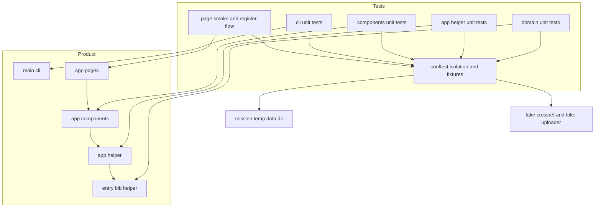
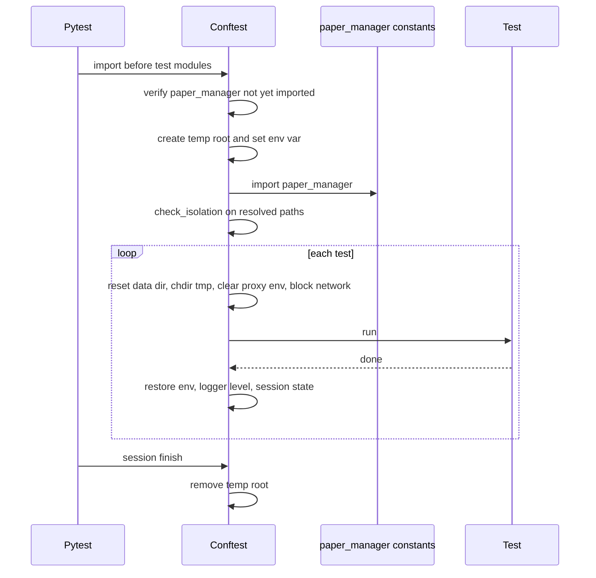
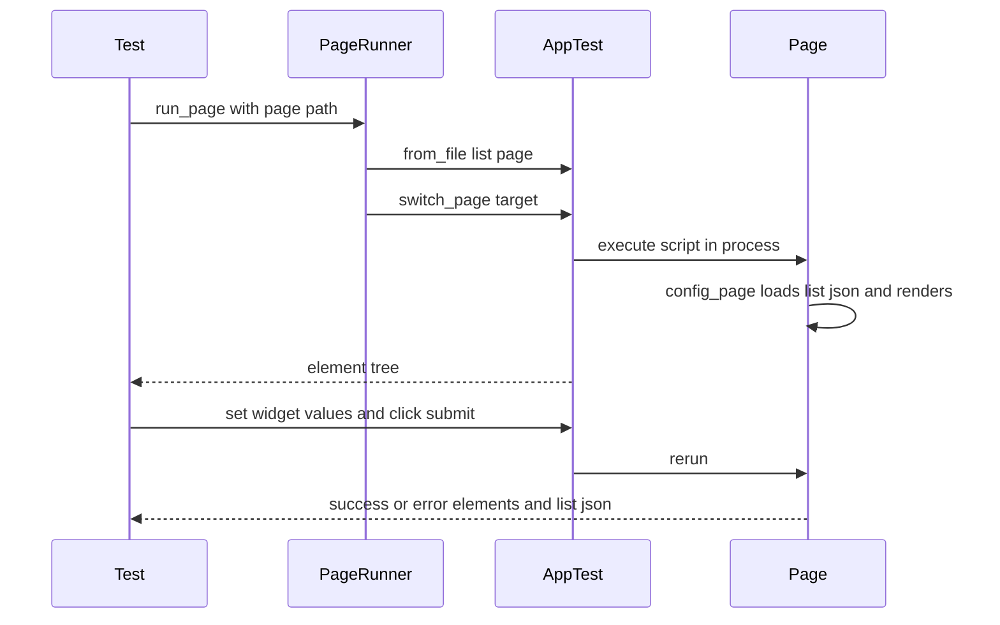

# Design Document

## Overview
**Purpose**: paper-manager の既存の振る舞いを自動テストで固定し、ユーザーデータを壊す回帰をリリース前に検出できるようにする。
**Users**: メンテナがローカルで `pytest -xs` を実行する場合と、CI（GitHub Actions、Python 3.9–3.13）が push のたびに実行する場合に使う。
**Impact**: 現状のテストは 2 件で、実データディレクトリから隔離されていない。これを、実データ・環境変数・作業ディレクトリ・外部ネットワークから隔離したテストスイートに置き換える。プロダクションコード（`src/`）は変更しない。

### Goals
- 環境変数を事前に設定しなくても、`pytest -xs` だけで実データに触れずに実行できる
- 要件 2〜12 の各受け入れ基準を、少なくとも 1 つのテストで検証する
- 既知バグを `xfail(strict=True)` で記録し、修正されたら記録の解除漏れを検出できる
- Python 3.9（Streamlit 1.50）から 3.13（最新の Streamlit）まで、同じテストが成功する

### Non-Goals
- `src/` 配下の修正（既知バグの修正、テストしやすくするためのリファクタリングを含む）
- カバレッジの計測、テストの並列実行、実ブラウザを使った E2E テスト
- CI ワークフロー（`.github/workflows/CI.yaml`）の変更、新しいテスト用依存の追加

## Boundary Commitments

### This Spec Owns
- `tests/` 配下のすべてのファイル（隔離の仕組み、共有 fixture、各テストモジュール）
- `pyproject.toml` の `[tool.pytest.ini_options]`（テストの探索パスと strict な xfail の既定値）
- 既知バグの一覧と、それぞれの「本来あるべき振る舞い」の記述（xfail テストとして）

### Out of Boundary
- `src/paper_manager/` 配下の振る舞い。テストは現状の振る舞いを観測するだけで、変更しない
- 既知バグの修正。修正を担う後続 spec が、xfail マーカーの削除も行う
- `logging` サブパッケージ、ページ固有機能（引用文、BibTeX/XML エクスポート、PDF 一括 zip、編集・削除）の詳細な検証
- CI ワークフロー、`[project.optional-dependencies].test` の変更

### Allowed Dependencies
- テストから、`paper_manager` の公開 API に加えて、各モジュールの `_` 始まりの関数（`_entry.sanitize_filename`、`_orphan_pdf._calculate_similarity` など）を参照してよい。現状の振る舞いを固定するのが目的のため
- 外部ライブラリは、既存の依存（`pytest`、`streamlit`（`streamlit.testing.v1.AppTest`）、`crossrefapi`、`pybtex`）と標準ライブラリに限る
- AppTest の API は Streamlit 1.50.0 に存在するもの（`from_file`、`from_function(args, kwargs)`、`switch_page`、`get`、各ウィジェット要素）に限る。`AppTest.file_uploader` など 1.56 以降の API は使わない
- 依存の向き: テストモジュール → `tests/conftest.py`（fixture）→ `paper_manager`。conftest はテストモジュールを import しない。テストモジュールどうしも互いを import しない

### Revalidation Triggers
- `_constants.py` のデータパスの決め方（環境変数名、import 時に確定する方式）の変更 → 隔離の前提が崩れる
- `config_page` のナビゲーション（`st.page_link` のパス）やページファイルの追加・改名 → `PAGES` とスモークテストの見直し
- `pyproject.toml` の Streamlit の下限、または CI の Python マトリクスの変更 → 使える AppTest の API の見直し
- 既知バグの修正 → 対応する xfail が `XPASS(strict)` で失敗するため、マーカーを外す
- 登録ページのウィジェットのラベル・キーの変更 → 結合テストでの要素の特定方法の見直し

## Architecture

### Existing Architecture Analysis
- データパスは import 時に確定し、利用側モジュールが値を束縛する（steering `tech.md`）。テストを確実に隔離するには、`paper_manager` の初回 import より前に環境変数を設定するしかない
- 各ページは `@config_page` を通して実行され、実行前に `list.json` を session state へ読み込み、実行後に書き戻す。サブページの `st.page_link` は、`_list.py` がエントリポイントである前提でパスを解決する
- ファイル操作の失敗は `(bool, message)` や件数で返し、UI 通知（`st.error` など）とログに出す。テストは戻り値と UI 通知の両方を観測する

### Architecture Pattern & Boundary Map



**Architecture Integration**:
- Selected pattern: 「import 前の隔離 + autouse fixture による初期化」（gap analysis の Option B）。プロダクションコードを変更せずに実データから隔離できる唯一の方法
- Domain/feature boundaries: 各テストモジュールは、プロダクションの 1 つのサブパッケージ・モジュール（またはページ群）にだけ対応する。共有するのは conftest の fixture だけ
- Existing patterns preserved: `tests/test_*.py` のフラット配置、AppTest によるページテスト、`pytest -xs`
- New components rationale: 隔離（IsolationHarness）、テストデータ（TestDataFactory）、外部の代替（ExternalFakes）、ページ実行（PageRunner）は、複数のテストモジュールが共有するため conftest に置く
- Steering compliance: Python 3.9 互換（`Union` / `Optional`、`typing.Dict` などは不要で組み込みジェネリクスを使う）、ruff の `line-length = 79`

### Technology Stack

| Layer | Choice / Version | Role in Feature | Notes |
|-------|------------------|-----------------|-------|
| Test runner | pytest（`.[test]` の既存依存、手元では 9.1.1） | テストの探索と実行、`monkeypatch`・`tmp_path`・`capsys` | 依存の追加はしない |
| UI テスト | `streamlit.testing.v1.AppTest`（Streamlit 1.50.0〜） | ページとフォーム部品の実行 | 1.50 にある API に限る |
| 外部 API の代替 | `crossref.restful.Works.doi` の monkeypatch | DOI 経路のオフライン検証 | 固定の辞書を返す |
| ネットワーク遮断 | 標準ライブラリ `socket` の monkeypatch | 外部ネットワークへのアクセス禁止 | AF_INET / AF_INET6 の接続と名前解決を拒否する |

## File Structure Plan

### Directory Structure
```
tests/
├── conftest.py               # IsolationHarness / TestDataFactory / ExternalFakes / PageRunner
├── test_isolation.py         # 隔離の仕組み自体の検証（ガード関数、パス定数、ネットワーク遮断、cwd）
├── test_entry.py             # Entry: 正規化、識別子、PDF フォルダ名、PDF 一覧、旧形式の移行 + 既知バグ
├── test_paper_list.py        # PaperList: ファイルとの往復、壊れた JSON、session state との同期
├── test_bib.py               # load_bib: 入力形式、著者の整形、複数エントリ、型エラー + 既知バグ
├── test_helper.py            # paper_manager.helper の各ユーティリティ
├── test_app_backup.py        # app.helper._backup: 作成、復元、往復、退避、不正 zip、情報取得 + 既知バグ
├── test_app_proxy.py         # app.helper._proxy: 優先順位、保存、適用、壊れた設定
├── test_app_orphan_pdf.py    # app.helper._orphan_pdf: 検出、類似度、削除 + 既知バグ
├── test_app_fields.py        # app.helper._config: MAP_FIELDS / MAP_REQUIRED_FIELDS / entrytype4doi
├── test_components.py        # app.components: PDF の保存・削除、登録・更新、入力フォーム部品 + 既知バグ
├── test_cli.py               # __main__: 引数処理、run / version、backup / restore + 既知バグ
├── test_pages_smoke.py       # 5 ページ × {空データ, サンプルデータ} のスモークテスト
├── test_register_flow.py     # 登録ページの BibTeX / DOI / 手動入力の結合テスト + 既知バグ
└── test_import.py            # 既存（pybtex の import 確認）をそのまま残す
```

### Modified Files
- `pyproject.toml` — `[tool.pytest.ini_options]` を追加し、`testpaths = ["tests"]` と `xfail_strict = true` を設定する（KnownBugConvention）。実行コマンドは変わらない（14.4）
- `tests/test_app.py` — 削除する。内容（`_list.py` の起動確認）は `test_pages_smoke.py` が包含する（14.3）

## System Flows

### テストセッションの隔離



- ガードが失敗した場合は `pytest.exit(..., returncode=1)` でセッション全体を止め、テストを 1 件も実行しない（1.3）
- 実行前に `PAPER_MANAGER_DATA_DIR` が設定されていた場合、その値を禁止パスに加えたうえで上書きする（1.1）

### ページ実行



- `fake_crossref` と `fake_file_uploader` は、同じプロセスで動くページスクリプトにも効くよう、モジュール属性（`crossref.restful.Works.doi`、`streamlit.file_uploader`）を差し替える

## Requirements Traceability

| Requirement | Summary | Components | Interfaces | Flows |
|-------------|---------|------------|------------|-------|
| 1.1, 1.2, 1.3 | 実データの保護、事前設定なしでの隔離、ガード | IsolationHarness, test_isolation | `check_isolation`, conftest のモジュールレベル処理 | テストセッションの隔離 |
| 1.4, 1.5, 1.6 | テストの独立性、プロセス状態の復元、作業ツリーを汚さない | IsolationHarness | `_isolate_each_test` | テストセッションの隔離 |
| 1.7 | 外部ネットワークの遮断 | IsolationHarness, ExternalFakes | `_isolate_each_test`, `fake_crossref` | — |
| 2.1, 2.2, 2.3, 2.4, 2.5, 2.6, 2.7, 2.8, 2.9 | Entry | test_entry, TestDataFactory | `make_entry`, `write_pdf` | — |
| 3.1, 3.2, 3.3, 3.4 | PaperList | test_paper_list, ExternalFakes | `st_messages` | — |
| 4.1, 4.2, 4.3, 4.4 | load_bib | test_bib | — | — |
| 5.1, 5.2, 5.3, 5.4, 5.5, 5.6 | 汎用ユーティリティ | test_helper | — | — |
| 6.1, 6.2, 6.3, 6.4, 6.5, 6.6, 6.7, 6.8 | バックアップ・復元 | test_app_backup, TestDataFactory | `data_paths`, `sample_data` | — |
| 7.1, 7.2, 7.3, 7.4, 7.5, 7.6 | プロキシ | test_app_proxy, IsolationHarness | `data_paths`, `monkeypatch.setenv` | — |
| 8.1, 8.2, 8.3, 8.4, 8.5 | 孤立 PDF | test_app_orphan_pdf, TestDataFactory | `sample_data`, `write_pdf` | — |
| 8.6, 8.7 | フィールド定義、エントリタイプの変換 | test_app_fields | — | — |
| 9.1, 9.2, 9.3, 9.4, 9.5 | PDF の保存・削除 | test_components, TestDataFactory | `FakeUpload`, `st_messages` | — |
| 9.6, 9.7, 9.8, 9.9, 9.10 | 登録・更新 | test_components | `st_messages`, `data_paths` | — |
| 9.11, 9.12 | 入力フォーム部品 | test_components, ExternalFakes | `AppTest.from_function`, `fake_file_uploader` | — |
| 10.1, 10.2, 10.3, 10.4 | 引数処理、run / version | test_cli | `cli.main_run` / `cli.main_version` の差し替え | — |
| 10.5, 10.6, 10.7, 10.8 | backup / restore サブコマンド | test_cli, TestDataFactory | `backup()`, `restore()` を直接呼び出す | — |
| 11.1, 11.2, 11.3, 11.4, 11.5 | 全ページのスモークテスト | test_pages_smoke, PageRunner | `run_page`, `PAGES`, `sample_data` | ページ実行 |
| 12.1, 12.2, 12.3, 12.4, 12.5, 12.6, 12.7, 12.8, 12.9 | 登録フロー | test_register_flow, PageRunner, ExternalFakes | `run_page`, `fake_crossref`, `fake_file_uploader` | ページ実行 |
| 13.1, 13.2, 13.3, 13.4, 13.5 | 既知バグの記録 | KnownBugConvention | `xfail_strict`, `"KNOWN BUG: "` 接頭辞 | — |
| 14.1, 14.2, 14.3, 14.4 | 実行性と保守性 | 全コンポーネント, pyproject | Streamlit 1.50 の API に限定、日時・OS の差し替え | — |

## Components and Interfaces

| Component | Domain/Layer | Intent | Req Coverage | Key Dependencies (P0/P1) | Contracts |
|-----------|--------------|--------|--------------|--------------------------|-----------|
| IsolationHarness | conftest | 実データ・プロセス状態・ネットワークからの隔離 | 1.1–1.7, 14.2 | `_constants`（P0） | Service, State |
| TestDataFactory | conftest | エントリ・PDF・サンプルデータの生成 | 2, 6, 8, 9, 11.2 | IsolationHarness（P0） | Service |
| ExternalFakes | conftest | Crossref・ファイルアップロード・UI 通知の代替 | 1.7, 3.3, 9, 12 | crossrefapi, streamlit（P0） | Service |
| PageRunner | conftest | トップページを起点にページを実行する | 11, 12 | AppTest（P0） | Service |
| KnownBugConvention | 各テストモジュール, pyproject | 既知バグを strict な xfail で記録する規約 | 13.1–13.5 | pytest（P0） | — |
| テストモジュール群 | tests/test_*.py | 各要件の受け入れ基準の検証 | 2–12, 14 | 上記 fixture（P0） | — |

### conftest

#### IsolationHarness

| Field | Detail |
|-------|--------|
| Intent | `paper_manager` の import 前にデータの保存先を一時ディレクトリへ向け、テストごとにプロセス状態を初期化・復元する |
| Requirements | 1.1, 1.2, 1.3, 1.4, 1.5, 1.6, 1.7, 14.2 |

**Responsibilities & Constraints**
- conftest のモジュールレベル（他のどの import よりも前）で次を行う
  1. `"paper_manager" in sys.modules` であれば `pytest.exit` で止める
  2. 禁止パスを集める: `Path.home() / ".paper-manager"` と、実行前の `PAPER_MANAGER_DATA_DIR` の値
  3. `tempfile.mkdtemp(prefix="paper-manager-test-")` で一時ルートを作り、`<root>/data` を `PAPER_MANAGER_DATA_DIR` に設定する
  4. `paper_manager._constants` を import し、`check_isolation` を実行する
- `pytest_sessionfinish` で一時ルートを削除する
- autouse fixture `_isolate_each_test` は、各テストの前に次を行う
  - データディレクトリの中身を削除して、空のディレクトリとして作り直す
  - `monkeypatch.chdir(tmp_path)` で作業ディレクトリを移す
  - `HTTP_PROXY`・`HTTPS_PROXY`・`http_proxy`・`https_proxy` を削除する
  - `socket.socket.connect`（AF_INET / AF_INET6 のみ）と `socket.getaddrinfo` を、`NetworkBlockedError` を送出する関数に差し替える
  - `os.environ` の写しと、ライブラリのルートロガーのレベルを保存する
- テストの後には、`os.environ` を写しの内容に戻し、ロガーのレベルを戻し、`st.session_state.clear()` で bare mode の session state を消す
- プロダクションのモジュール属性は差し替えない（データパスは環境変数だけで決まる）

**Contracts**: Service [x] / State [x]

##### Service Interface
```python
class IsolationError(RuntimeError): ...
class NetworkBlockedError(RuntimeError): ...

class DataPaths(NamedTuple):
    root: Path         # == paper_manager._constants.DIRPATH_DATA
    pdf: Path          # == DIRPATH_PDF
    list_file: Path    # == FILEPATH_LIST
    config_file: Path  # == FILEPATH_CONFIG

def check_isolation(
    data_dir: Path, temp_root: Path, forbidden: Iterable[Path]
) -> None: ...
# raises IsolationError when data_dir is not under temp_root
# or equals / is under any forbidden path

@pytest.fixture
def data_paths() -> DataPaths: ...

@pytest.fixture(autouse=True)
def _isolate_each_test(
    monkeypatch: pytest.MonkeyPatch, tmp_path: Path
) -> Iterator[None]: ...
```
- Preconditions: conftest のモジュールレベル処理は、どのテストモジュールよりも先に実行される（pytest の仕様）
- Postconditions: 各テストの開始時点で、データディレクトリは空で存在し、cwd は `tmp_path` である
- Invariants: `DIRPATH_DATA` は常に一時ルートの配下にある

##### State Management
- State model: セッション共通の一時ルートは 1 つ。テストごとの状態（データディレクトリの中身、環境変数、cwd、ロガーのレベル、session state）は、各テストの前後で初期化・復元する
- Concurrency strategy: 直列実行が前提。並列実行（xdist）には対応しない

**Implementation Notes**
- Integration: pytest のキャッシュは `.pytest_cache`（`.gitignore` で除外済み）に書かれ、テスト由来のファイルには当たらない
- Validation: `test_isolation.py` で、`check_isolation` の正常系と異常系、`DataPaths` の各パスが一時ルートの配下にあること、外部への接続が `NetworkBlockedError` になること、cwd が `tmp_path` であることを検証する
- Risks: 他の pytest プラグインが conftest より前に `paper_manager` を import した場合は、ガードが止める（フェイルセーフ）

#### TestDataFactory

| Field | Detail |
|-------|--------|
| Intent | テストで使うエントリ・PDF・サンプルデータを、隔離されたデータディレクトリに作る |
| Requirements | 2.6, 2.7, 2.8, 6.1, 6.4, 8.1, 9.1, 11.2 |

**Contracts**: Service [x]

##### Service Interface
```python
PDF_BYTES: bytes  # b"%PDF-1.4\n%test\n"

def write_pdf(path: Path, content: bytes = PDF_BYTES) -> Path: ...
# creates parent dirs, writes content, returns path

class FakeUpload(io.BytesIO):
    name: str
    def __init__(self, name: str, content: bytes) -> None: ...

class SampleData(NamedTuple):
    paper_list: PaperList   # saved to data_paths.list_file
    with_pdf_key: str       # entry with 00.pdf and 01.pdf
    without_pdf_key: str    # entry without PDF
    orphan_pdf: Path        # pdf/<unknown dir>/00.pdf

@pytest.fixture
def make_entry() -> Callable[..., Entry]: ...
# make_entry(**fields) -> Entry; defaults:
# ENTRYTYPE=article, author, title, journal, year (overridable)

@pytest.fixture
def sample_data(
    data_paths: DataPaths, make_entry: Callable[..., Entry]
) -> SampleData: ...
```
- Postconditions: `sample_data` は `list.json`、`config.json`（プロキシ設定を含む）、PDF 2 件を持つエントリ（日本語タイトル）、PDF のないエントリ、孤立 PDF を 1 件作る
- 3.1、6.4、11.2 で同じデータを使い回す

#### ExternalFakes

| Field | Detail |
|-------|--------|
| Intent | Crossref API・ファイルアップロード・UI 通知を、テストから制御できる代替に差し替える |
| Requirements | 1.7, 3.3, 9.3, 9.7, 9.10, 9.12, 12.2, 12.4, 12.5, 12.9 |

**Contracts**: Service [x]

##### Service Interface
```python
CrossrefMetadata = dict[str, Any]

def crossref_article(doi: str = "10.1234/test") -> CrossrefMetadata: ...
# journal-article metadata with title, author, container-title, published

@pytest.fixture
def fake_crossref(
    monkeypatch: pytest.MonkeyPatch,
) -> Callable[[Optional[CrossrefMetadata]], list[str]]: ...
# install(metadata) replaces crossref.restful.Works.doi;
# returns a list that records requested DOIs

Uploads = Union[FakeUpload, list[FakeUpload], None]

@pytest.fixture
def fake_file_uploader(
    monkeypatch: pytest.MonkeyPatch,
) -> Callable[[Mapping[str, Uploads]], None]: ...
# install({label_prefix: files}) replaces streamlit.file_uploader;
# unmatched labels fall back to the original function

class StMessages(NamedTuple):
    error: list[str]
    warning: list[str]
    success: list[str]

@pytest.fixture
def st_messages(monkeypatch: pytest.MonkeyPatch) -> StMessages: ...
# replaces streamlit.error / warning / success with recorders
```
- Constraints: `st_messages` は AppTest を使うテストでは使わない（ページの要素が生成されなくなるため）
- `fake_file_uploader` は、`accept_multiple_files=True` でも単体の値を返せるようにする（9.12 の「単一でも一覧で返る」の検証のため）

#### PageRunner

| Field | Detail |
|-------|--------|
| Intent | トップページ（`_list.py`）を起点に対象ページへ移り、AppTest で実行する |
| Requirements | 11.1, 11.2, 11.3, 11.4, 11.5, 12.1, 12.2, 12.3, 12.4, 12.5, 12.6, 12.7, 12.8, 12.9, 14.3 |

**Contracts**: Service [x]

##### Service Interface
```python
APP_DIR: Path  # Path(paper_manager.__file__).parent / "app"
PAGES: tuple[Optional[str], ...] = (
    None,                   # _list.py
    "pages/_register.py",
    "pages/_backup.py",
    "pages/_restore.py",
    "pages/_settings.py",
)
APP_TIMEOUT_SECONDS: float = 30.0

def run_page(page: Optional[str]) -> AppTest: ...
# AppTest.from_file(APP_DIR / "_list.py", default_timeout=...),
# switch_page(page) when page is not None, then run()
```
- Postconditions: 返り値の `AppTest` は 1 回実行済み。呼び出し側はウィジェットを操作して `run()` を呼べる
- Constraints: サブページを `from_file` で直接開かない（`st.page_link` が `StreamlitPageNotFoundError` になる）

#### KnownBugConvention

| Field | Detail |
|-------|--------|
| Intent | 既知バグを「本来あるべき振る舞いを期待するテスト」として記録する規約 |
| Requirements | 13.1, 13.2, 13.3, 13.4, 13.5 |

**Responsibilities & Constraints**
- `@pytest.mark.xfail(reason="KNOWN BUG: <不具合の内容>. Repro: <再現条件>")` を付ける。`pyproject.toml` の `xfail_strict = true` によって strict になる（13.3）
- `raises=` は付けない。期待する振る舞いを assert し、現状の例外も期待との不一致も「既知の失敗」として扱う
- テストは、対応するドメインのテストモジュールに置く

| ID | 不具合 | 置き場所 | 期待する振る舞い（assert する内容） |
|----|------|--------|----------------------------|
| KB1 | CLI の backup / restore が `SystemExit(2)` になる | test_cli | `main(["backup", "-o", p])` で `p` が作られる。`main(["restore", p, "--force"])` で `list.json` が復元される |
| KB2a | 著者のないエントリの PDF フォルダ名生成で `IndexError` | test_entry | `pdf_dir_name == "2020 - Unknown - T"` |
| KB2b | タイトルのないエントリの PDF 一覧取得で `KeyError` | test_entry | `get_pdf_files() == []` |
| KB2c | 著者のない BibTeX の読み込みで `KeyError` | test_bib | 例外にならず、`author` が空または存在しない |
| KB3 | 復元時にデータディレクトリの外へ書き込まれる | test_app_backup | `pdf/../../escaped.pdf` を含む zip を復元しても、データディレクトリの外にファイルが作られない |
| KB4a | 手動入力の著者が `, ` 区切りで保存される | test_components | 著者 2 名を入力すると `"A B and C D"` になる |
| KB4b | 手動入力でタグの既定値が ` and ` で分割される | test_components | 既定値 `"x, y"` の選択肢が `["x", "y"]` になる |
| KB4c | 複合姓・ミドルネームが欠落する | test_bib | `van der Waals, Johannes Diderik` に `van der Waals` と `Johannes Diderik` が含まれる |
| KB4d | 孤立 PDF の削除にフォルダを渡すと件数が 0 になる | test_app_orphan_pdf | PDF 2 件を含むフォルダを渡すと 2 が返る |
| KB5 | Windows 用の置換規則に `"` が含まれない | test_entry | `platform.system()` を `"Windows"` に差し替えると、`"` が `_` に置換される |
| KB6 | 不正な BibTeX 構文で登録ページが例外で落ちる（設計フェーズで判明、13.4） | test_register_flow | `@article{k, title={T}`（閉じ括弧なし）を登録すると、ページ例外にならずにエラーが表示され、論文リストが変わらない |

**Implementation Notes**
- Validation: 実装中に新しいバグが見つかった場合（13.4）は、同じ規約で追加し、上表に行を追記する
- Risks: 修正 spec が別のバグも同時に直すと、関係のない xfail が `XPASS(strict)` になる。その場合は、その spec が該当するマーカーも外す

### テストモジュール群（summary-only）

各モジュールは、トレーサビリティ表の要件を検証する。新しい境界は持たない。以下には、要件の解釈に関わる実装方針だけを示す。

- **test_entry**: 2.5 は `monkeypatch.setattr(_entry.platform, "system", ...)` で `"Windows"` と `"Linux"` の両方を検証する。2.4 は 300 文字のタイトルを使い、名前が 200 文字以下で、末尾が `.` や空白でないことを検証する。2.7 と 2.8 では `DeprecationWarning` が出ることを許容する（`pytest.warns` か `filterwarnings`）。2.9 は `base_dir=tmp_path / "pdfs"` を使い、`data_paths.pdf` が変化しないことも検証する
- **test_paper_list**: 3.3 は `st_messages.warning` に `"Broken paper list (json)"` が含まれることを検証する
- **test_bib**: 4.1 は `io.StringIO`、`io.BytesIO`、`tmp_path` 上のファイルパスの 3 通りの結果が等しいことを検証する
- **test_helper**: 5.2 は `pytest.warns(DeprecationWarning)` を使い、`__doc__` が `.. deprecated::` で始まることを検証する
- **test_app_backup**: 6.4 は `sample_data` からバックアップを作り、データディレクトリを空にしてから復元し、`list.json`・`config.json`・PDF の相対パスとバイト列が一致することを検証する
- **test_app_proxy**: 7.6 は `apply_proxy_to_environment()` の後で 4 つの環境変数を検証する（後片付けは IsolationHarness が行う）
- **test_app_fields**: 8.6 は `fields.json` を独立に読み込み、`MAP_REQUIRED_FIELDS` と照合する
- **test_components**: 9.3 は `base_dir` に長いディレクトリを指定して、パスを 250 文字超にする。9.11、KB4a、KB4b は、`custom_entry` を呼ぶスクリプトを `AppTest.from_function` で実行し、結果を `st.session_state` に書き出して読む。年は明示的に入力する（14.2：今日の日付に依存しない）
- **test_cli**: 10.2 は `paper_manager.__main__.cli.main_run` / `main_version` を、引数を記録する関数に差し替える。10.5 は `backup([])` を呼び、cwd（`tmp_path`）に `paper-manager-backup_\d{8}_\d{6}\.zip` に一致するファイルが 1 件作られることを検証する。10.7 は `builtins.input` を差し替える。10.8 は、zip ではない既存のファイルを指定する
- **test_pages_smoke**: `PAGES` × {空データ, `sample_data`} でパラメータ化する。`at.exception` が空であること、`at.title` に `PAPER MANAGER` が含まれること、`at.get("page_link")` が 5 件であること、`list.json` の内容（`json.load` した辞書）が実行前後で等しいことを検証する。空データでは実行中に `list.json` が作られるため、実行前に存在しなければ空の辞書として比べる
- **test_register_flow**: ウィジェットはラベルで特定する（`DOI`、`BibTeX形式のテキストを入力`、`エントリタイプを選択`）。送信ボタンは同じラベル `📤 登録` が 3 つあるため、出現順（BIB、DOI、CUSTOM）のインデックスで特定する。12.3 の「有効なエントリを含まない」には、構文として成立する非 BibTeX テキスト（`hello`）を使う（構文エラーになるテキストは KB6）。12.7 の DOI 経路は、`type: "book"`（`publisher` が欠落）の固定応答を使う

## Error Handling

### Error Strategy
- 隔離ガードの失敗: `pytest.exit` でセッションを止める。メッセージには、検出したパスと禁止パスを含める（1.3）
- 外部ネットワークへのアクセス: `NetworkBlockedError("network access is blocked in tests: <host>")` を送出する。テストは通常の失敗として報告される（1.7）
- AppTest の例外: スモークテストは、`at.exception` の内容をそのまま assert メッセージに含め、原因を追えるようにする
- 既知バグ: xfail として扱う。修正されたら `XPASS(strict)` で失敗する（13.3）

### Monitoring
- CI のログ（`pytest -xs`）だけを使う。`-s` を付けるため、AppTest やロガーの出力もそのままログに残る

## Testing Strategy

本 spec の成果物自体がテストのため、ここでは「テストスイートが正しく機能していること」を確かめる観点を示す。

- **隔離の検証（test_isolation）**: `check_isolation` が、一時ルートの外と禁止パスを拒否すること。`DataPaths` の 4 つのパスが一時ルートの配下にあること。`socket.create_connection(("example.com", 80))` が `NetworkBlockedError` になること。cwd が `tmp_path` であること
- **既知バグの規約の確認**: 実装の完了時に `pytest -xs -rxX` を実行し、xfailed のテストが KnownBugConvention の表のすべての行に対応し（KB1 は backup と restore の 2 件）、XPASS が 0 件であることを確認する
- **実データを汚さないことの確認**: 実装の完了時に、`~/.paper-manager` で `find -newer` を実行し、テストの実行中に更新されたファイルが 0 件であることを確認する。テストの実行前後で `git status --porcelain` に差分が増えないことも確認する（1.1、1.6）
- **バージョン互換の確認**: 手元（Python 3.12、Streamlit 1.66）で成功したうえで、CI の全マトリクス（Python 3.9 / Streamlit 1.50 を含む）で成功することを確認する（14.1）

## Security Considerations
- KB3（パストラバーサル）の再現テストでは、`../../` の到達先が一時ルートの中に収まるよう深さを選ぶ（データディレクトリ `<temp_root>/data` に対して `pdf/../../escaped.pdf` → `<temp_root>/escaped.pdf`）。テストの後には、その到達先を削除する
- 実データの保護は IsolationHarness のガードで担保し、テストコード側の注意に頼らない
